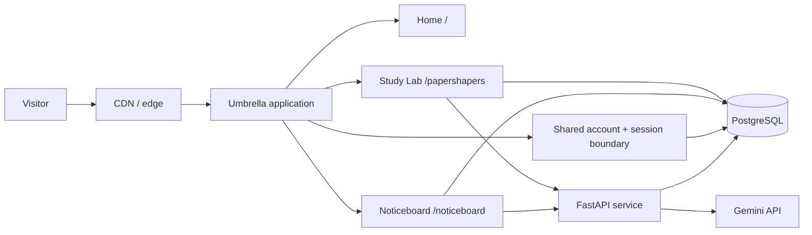
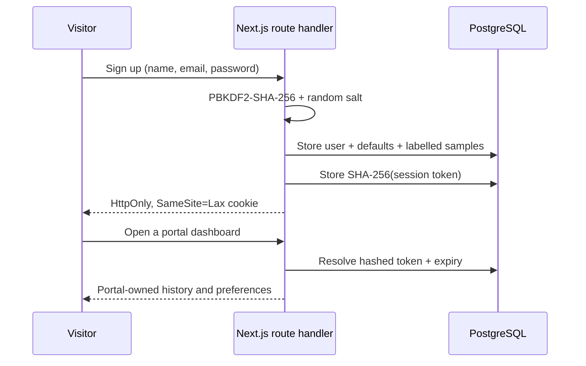
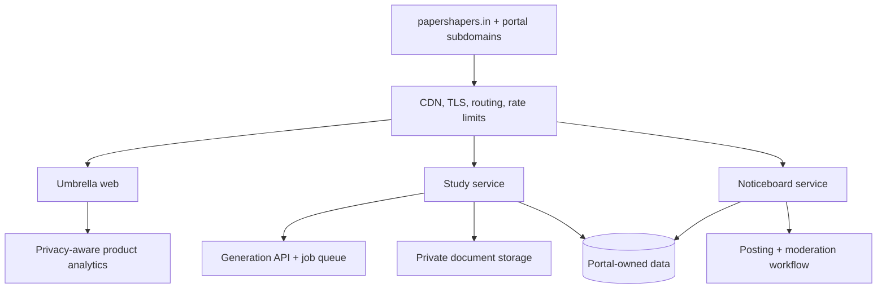

# Paper Shapers system design

## Objective

Build a recognisable umbrella brand that can launch several focused services cheaply, validate them independently, and extract successful products into subdomains or separate deployments without a front-end rewrite.

## Current system (phase 1)

The web application is a standard Next.js deployment. Pages render on the server; only focused controls hydrate in the browser. PostgreSQL stores accounts, sessions, user-visible history, generated content, attempts, rooms, and preferences. Vercel and Render use separate least-privilege roles against one migrated schema; FastAPI owns generated content and model calls. Same-origin web API routes enforce identity and shield model credentials. Private Study pages redirect anonymous visitors to sign-in; the corresponding web APIs return `401` without a valid session, and FastAPI rejects private routes unless its server-to-server shared secret is configured and supplied.

## Identity and access

## Target system (phases 2–3)

Suggested domain map:

| Surface | Phase 1 | Future subdomain |
| --- | --- | --- |
| Umbrella | `/` | `papershapers.in` |
| Study Lab | `/papershapers` | `learn.papershapers.in` |
| Noticeboard | `/noticeboard` | `nearby.papershapers.in` |

The single Worker is attached to every hostname. It internally rewrites `/` and `/dashboard` to the corresponding portal route; it does not send an HTTP redirect, so the public URL remains the subdomain. Extraction should happen only when a portal needs a distinct backend, security boundary, team, or release cadence.

## Current data model

| Table | Ownership and purpose |
| --- | --- |
| `users` | Shared identity only; unique email and salted password derivative |
| `sessions` | Shared hashed opaque sessions with a 30-day expiry |
| `study_requests` | Study-owned request/history records, including labelled demo rows and a nullable paper ID linking new briefs to the corresponding private generated paper |
| `generated_paper_cache` | Study-only, expiry-bound identity-free validated paper content; recovery-only, never attempts or learner records |
| `paper_feedback` | Study-owned, owner-scoped category/comment signal for human review; excluded from live prompts and learner scoring |
| `contact_submissions` | Public Study contact/feedback notes with minimal reply context; separate from learner papers and never published as testimonials without permission |
| `community_posts` | Study Journal editorial guides and signed-in user submissions. User submissions begin `pending`; only explicitly reviewed `published` entries are visible publicly. |
| `test_rooms` | Study-owned educator live test rooms linked to a teacher ID and paper ID, with session status (`waiting`, `active`, `completed`). |
| `test_attendees` | Student participants in a live test room with name, roll number, status (`joined`, `completed`), JSON-serialized question responses, and score. Cascades on room deletion. |

Portal queries always include `user_id` and, for shared storage, a portal discriminator. Future services should receive the stable user ID through a signed identity contract rather than query shared credentials.

Public contact submission is the exception: it does not require an account, accepts a short validated message, and stores only the contact details supplied for a reply. It is deliberately separate from student answers, attempts, and model prompts.

The Study Journal is a deliberately small moderation boundary rather than an unbounded forum: a signed-in learner may submit a title, summary, and note; the write route records it as `pending`; public pages query only `published` entries. There is no direct-message, comments, upload, public profile, answer-sharing, or automatic publishing capability. Paper Shapers starter guides are marked as editorial content rather than user activity.

Teacher Live Rooms provide a lightweight, friction-free session boundary: hosting requires an authenticated teacher account, whereas student attendees join using only their name and roll number. Access is managed via scoped HTTP-only session cookies (`attendeeId_{roomId}`) to prevent submission cross-talk without burdening students with mandatory account sign-up. Student responses remain private between the attendee and the hosting teacher.

## Portal boundaries

- **Study Lab:** curricula, practice configuration, uploads, generation jobs, answer keys, saved work.
- **Noticeboard:** places, geographic cells, posts, expiry, verification, reports, moderation.
- **Umbrella:** discovery, shared brand, cross-navigation, legal pages, and aggregate status only.

Each portal owns its data. The umbrella may consume a small public catalogue API later, but it must not query portal tables directly.

## Key backend flows

### Provider routing

The Study router uses an explicitly configured ordered sequence of Gemini, Groq, and NVIDIA NIM. Each provider owns a local key ring: a request rotates its starting slot and only tries remaining slots after a failure, then proceeds to the next configured provider. It is deterministic routing, not an agent. Every provider receives the same source-bounded request and must return valid JSON that survives the Study schema/mark validation; invalid output is a provider failure and is never saved. A deterministic mock is available only when explicitly enabled for tests. A fresh run fails closed instead of saving template content. After a successful real run, the backend stores an identity-free, expiry-bound cache entry keyed by the canonical paper brief and prompt/source version. It creates a private copy from that cache only after every real provider fails; attempts and learner data are never shared. Provider failures are summarized internally and never expose keys or upstream response bodies.

### Study generation

1. Validate curriculum, class, chapter, intent, and limits.
2. The prototype generates synchronously; before production, replace this with an idempotent queued job so request workers do not remain open for model work.
3. Retrieve approved curriculum context and, when authorised, user documents.
4. Generate structured questions and answers, then validate schema and safety.
5. Persist the result and notify the client by polling or server events.
6. Expire private uploads on a documented schedule.

### Study paper lifecycle (current prototype)

1. A signed-in learner creates a half or full paper from the Study landing route.
   The dedicated planner reads the supplied local Paper Shapers chapter-content source and validates the selected Class 1–12 subject and chapters against it.
2. The backend saves an owner-scoped structured paper and the browser navigates to a dedicated reader route.
3. The learner opens a distraction-free attempt route and submits responses.
4. The backend stores an owner-scoped attempt and returns formative per-question feedback, including the source question and submitted answer alongside marks and the answer outline.
5. The result is visible on its own route and the dashboard lists the newest papers while a signed-in, owner-scoped paginated archive retains access to older papers. Each newly generated brief stores its matching paper ID, so the request history can reopen that exact paper without guessing from title or date.

The generated-paper reader also supports the browser's native print/save-to-PDF path and optional owner-scoped feedback. A rule-based Study Guide routes common learner and educator needs to existing flows and FAQs. It does not act as an LLM agent, answer arbitrary homework questions, or send free-form support input to a model. Feedback remains out of live prompts until an authorised human review process and evaluation plan exist.

Scores are explicitly practice estimates. They must not be represented as official marks or used for high-stakes learner decisions without validated rubrics and educator oversight.

The UI shows a paper-derived timer and locally autosaves unsubmitted draft answers on that device. Before display, a model-assisted result must match the generated question IDs, use numeric marks, and stay within each question's mark cap; a failed check falls back to the local practice rubric. Both paths keep the generated question and learner response in the stored review record, so the client never has to recreate result context. This is schema validation, not independent verification that an academic answer is correct.

### Google identity link

Password accounts remain supported. When `GOOGLE_CLIENT_ID`, `GOOGLE_CLIENT_SECRET`, and `GOOGLE_OAUTH_REDIRECT_URI` are configured, `/auth` also offers a Google authorization-code flow. The browser receives a short-lived HTTP-only, SameSite=Lax state cookie before redirecting to Google. The callback verifies that state, exchanges the code server-side, requires a verified email, then stores only `provider`, provider subject, verified email, and the linked Paper Shapers user ID in `auth_identities`. It does not request product-data scopes or store access/refresh tokens. A matching verified email may link an existing password account; all other identity collisions fail closed. The launch configuration and required callback tests are documented in [LAUNCH_READINESS.md](LAUNCH_READINESS.md).

### NCERT & CBSE Textbook Scraper and Tabular Curriculum Pipeline

To ensure curriculum data remains synchronized with authentic NCERT textbook editions without fragile manual CSV entry:
1. **Official Source Scraper:** A Python pipeline (`scripts/ncert_curriculum_scraper.py`) scrapes the official NCERT portal (`https://ncert.nic.in/textbook.php`), discovering over 1,100 books across Classes 1–12, focusing on CBSE Classes 1–12. It supports both high-speed headless HTTP parsing and interactive Selenium WebDriver automation.
2. **Automated Chapter PDF Ingestion:** Resolves chapter PDF URLs, downloads and caches textbook PDFs locally under `data/ncert_pdfs/{class}/{subject}/`, and extracts clean academic text using PyMuPDF (`fitz`), stripping publisher boilerplate.
3. **Modern Tabular Architecture:**
   - **SQLite Database Store (`data/curriculum_store.sqlite`):** Stores structured book metadata and chapter text with indexes on `(grade, subject)` for instant query performance.
   - **Hierarchical JSON Catalog (`data/curriculum_catalog.json`):** Lightweight cached index of classes, subjects, book titles, and chapter counts.
   - **Local study-source CSV (`data/study-source/text_files_data2.csv`):** Auto-synchronized UTF-8 export used by the active backend. It is imported operational data and is excluded from Git.
   - **Backend Loader (`backend/app/curriculum.py`):** Automatically detects and prioritizes the indexed SQLite store, falling back cleanly to CSV when offline.
4. **Recurrence & Manual Triggers:** Configured for semi-annual (6-month) cron execution (`0 0 1 */6 *`) or Windows Task Scheduler automation, with on-demand manual triggers via `--run-now` and test verification via `--sample`.

### Live test rooms (teacher verification, session loop, and AI evaluation)

1. **Teacher Verification Layer:** To prevent unauthorized room creation, hosting live test rooms requires verified educator status stored in `user_roles` (`role = 'teacher'`). Users register their role and institution at signup or can verify through the educator verification gate on the live rooms dashboard.
2. **Flexible Paper Selection:** Teachers can initialize sessions using any standard CBSE Class 1–12 syllabus option (subject, grade, and full/half size), an existing paper from their saved library, or a custom paper ID. Rooms are registered in `test_rooms` (status: `waiting`).
3. **Frictionless Student Participation:** Students access `/papershapers/room` or `/papershapers/room/:roomId` and enter their name and roll number without requiring account creation.
4. **Session Security:** The server validates room availability, assigns an attendee record in `test_attendees` (`joined`), and sets a scoped HTTP-only session cookie (`attendeeId_{roomId}`) to prevent cross-submission tampering.
5. **Interactive Question Visualization:** Paper questions automatically adapt their rendering based on type: MCQs feature interactive selectable choice tiles with radio indicators; short-answer items render focused text inputs; long-form items render structured response textareas.
6. **Teacher Session Controls:** The teacher starts the test via `startRoomAction` (verified by teacher ID ownership), moving the room status to `active`.
7. **Submission & Storage:** Upon student submission, answers are verified against the cookie session and persisted in `test_attendees` with status `completed`.
8. **On-Demand AI Evaluation Layer:** Teachers can trigger an AI evaluation on any completed submission via `evaluateAttendeeAction`. The evaluation calls the study attempts endpoint (or falls back to a deterministic marking rubric) to assess responses against expected outlines, calculate earned marks/percentages, and generate question-level constructive feedback. The structured assessment is persisted in `test_attendees.ai_evaluation`.
9. **Formative Assessment Disclaimers:** All AI evaluations and mock papers carry explicit formative notices clarifying that scores are practice estimates designed to aid educator review, not official examination results.

1. Ingest licensed feeds and primary sources; preserve canonical URLs and timestamps.
2. Cluster reporting about the same event.
3. Extract claims separately from commentary.
4. Produce viewpoint drafts with source-level citations and uncertainty markers.
5. Require human editorial approval for publication and corrections.
6. Publish a versioned article; never silently rewrite an earlier analysis.

### Noticeboard posting

1. Establish approximate area with explicit visitor choice; precise location is optional.
2. Verify business contact or community identity before high-volume posting.
3. Store a structured post with category, area, start/end time, and expiry.
4. Run automated risk checks, then route reports and uncertain cases to moderation.
5. Rank primarily by distance, freshness, and relevance—not paid engagement.

## Security and trust controls

- Rate-limit generation, authentication, publishing, and reporting separately.
- Use short-lived signed upload URLs; scan documents before processing.
- Isolate uploaded content from prompts and treat it as untrusted data.
- Minimise location precision and never expose a private user's exact coordinates.
- Expire noticeboard posts by default and record moderation actions.
- Add consent-aware analytics; avoid cross-portal behavioural profiles.
- Store secrets only in the hosting platform, never in client bundles or the repository.
- Do not enable an advertising provider until its publisher identifier, privacy disclosures, consent flow where required, and content review are in place. Student answers and attempts must not be advertising-targeting signals.
- Do not import legacy source-research helpers that embed provider credentials or discard source provenance. Research features must retain dated citations and a reviewer boundary.
- Before public launch, add durable edge/WAF rate limits for credentials, OAuth entry/callback, public forms, content generation, and room joins. Input validation and SameSite cookies are not a substitute for abuse controls.
- Before public launch, provide and rehearse an account-deletion workflow that removes all user-linked rows from the shared PostgreSQL schema and any retained provider-side data.

## Deployment strategy

The selected baseline is Vercel for standard Next.js, Render for FastAPI and its persistent worker, and Neon for shared PostgreSQL. Set `BACKEND_ORIGIN` and the shared service secret only in server environments; do not expose provider keys to browser code. Local PostgreSQL mirrors the hosted persistence boundary, while SQLite remains an isolated backend-test fallback. No local command publishes by accident.

This workspace remains local-only until the owner explicitly publishes it. The deployment and network checklist is maintained in [Vercel deployment guide](production/02-vercel/README.md).

Recommended rollout:

1. Ship this public prototype and collect task-level feedback.
2. Validate the connected vertical slice now present in each portal.
3. Add approved source/curriculum data, job queues, and portal moderation as usage proves the need.
4. Introduce subdomain aliases, then separate deployments when operational needs diverge.

## Quality gates

- Production build and structural tests pass.
- No starter metadata or prototype-only dependencies remain.
- Critical interactions work with keyboard and touch.
- Layout is reviewed at approximately 390 px, 768 px, and 1440 px.
- Demo content is visibly described as illustrative.
- The relevant README and this design document reflect every architecture change.

The shared and portal-specific interaction rules are maintained in [UI_UX_GUIDE.md](UI_UX_GUIDE.md). Operational commands and the local-to-hosted handoff are maintained in [../RUNBOOK.md](../RUNBOOK.md).
# Production target decision

The selected experimental production topology is Vercel for the web runtime, Render for FastAPI and its persistent worker, and Neon for shared PostgreSQL. Browser traffic remains same-origin at Vercel; authenticated server routes proxy to Render using a rotating high-entropy shared secret. Both services use separate least-privilege database roles. Direct browser-to-Render traffic is outside the supported flow.

The shared PostgreSQL migration, both runtime adapters, least-privilege local roles, and idempotent legacy-data importer are implemented and tested locally. Backend SQLite remains an isolated test fallback. See [Vercel deployment guide](production/02-vercel/README.md).

## Student production hardening — 9 October 2026

Study public curriculum routes consume `/v1/study/catalog` rather than an ignored web-host JSON file. Live Room attendee recovery requires the existing scoped HTTP-only cookie; roll numbers are not recovery credentials. Student client props exclude answer outlines. Submission conditionally updates only joined attendees in an active room. Educator self-declaration does not grant independent verification. Production assessment rejects invalid/nonfinite model marks in the provider retry chain. PostgreSQL `request_limits` adds shared fixed-window budgets; Web migrations/grants run in a separate trusted operator/CI step. Vercel prebuild verifies existing schema without owner credentials. Browser draft deadlines use wall-clock time and drafts logically expire after 24 hours; this is not server-backed recovery or enforced exam timing. Source revision endpoints support cross-service deployment verification. See `STUDENT_PLATFORM_AUDIT.md` for unresolved launch gates.

## Scientific content contract
Question JSON optionally carries version-1 circuit, uniform-field or flow specifications, validated before generation persistence. Code-owned SVG geometry renders escaped labels through a shared question renderer; Markdown/LaTeX and KaTeX mhchem handle notation. Original diagram data accompanies scoring and review snapshots. Cache identity includes diagram schema version. No new storage table, external rendering service or paid capability is introduced. Contract and limitations: `docs/QUESTION_CONTENT.md`.

## Backend migration recovery

## Two-portal storage and lifecycle
Study and Noticeboard share identity; all public routes and background jobs belong to those products. Marketplace preferences now use the reserved `__preferences__` saved-item metadata record, excluded from saved-item lists and protected from generic saved-item writes. Existing market preferences are read from the original table until a new record is saved. This avoids inserting into the obsolete required column on older databases. The explicit owner-run cleanup migration removes retired storage while preserving accounts, study content and marketplace preferences. Retired routes return 404; startup checks only the initial schema.

## Generation request boundary
Paper generation runs in the FastAPI lifespan worker. Versioned job endpoints accept a brief and expose owner-scoped status; web API requests enqueue/poll with a 15-second upstream budget. The existing generated_papers row stores a queued request, a running lease in status, or a completed paper. Conditional updates claim work across processes. Model execution is bounded to 240 seconds, shorter than the 300-second lease; process restarts recover queued work. Readers and archives select only generated rows. This uses existing least-privilege runtime table access and no new hosted service or schema migration. A browser disconnect does not cancel accepted work. Failed/queued records are not papers and cannot be assessed. Deploy backend first, then frontend.

## Board mock domain contract
CBSE session/grade/subject-code profiles preallocate 38 Maths slots. Unit marks come from official curricula; chapter scheduling is an internal template. Full NCERT sources are resolved by textbook section identity, not ambiguous split-volume file labels. Four-slot generation batches retrieve topic-ranked text chunks; structural checks, independent model checks and bounded repairs precede full assembly validation. Hash/chunk provenance is stored in each question. JSON recursively represents subparts, alternative branches, plots and marking steps. Backend/public responses omit grading data; assessments resolve only the selected branch. Draft status stays educator-review-pending. Board jobs receive a separate longer execution/lease budget and need no new persistence tables or paid service. Plot figures are bounded point/line schematics, not arbitrary SVG or executable markup; axes and numeric information must be explicit. Full function plotting/circles are not inferred by the renderer.

## Optional billing and mobile boundary — 10 October 2026

The web owns Razorpay Orders creation, signed callback/webhook reconciliation and owner-scoped PostgreSQL `billing_orders`. The indexed paid, unexpired membership grants are read by the backend queue only when `BILLING_ENABLED=true`. Priority ages free work after ten minutes, does not preempt running work and adds no provider concurrency. Membership is prepaid for 30 days with manual renewal; contributions grant no access. Capture grants once under owner/order row locks; refunds revoke that grant and terminal status blocks late-event resurrection. Secrets and merchant configuration stay server side. No card data, study answers or raw webhook payload is stored. Migration `0007_billing` and least-privilege web write/backend read grants precede activation. The PWA manifest, icons, install guide and service worker share the existing web runtime; only the generic offline page is cached. A directly downloadable Android launcher now opens the hosted site in a browser Custom Tab. Store publication/billing and an iOS binary remain outside the shipped boundary. Full contract and activation gates: `BILLING_AND_MOBILE.md`.

## Android download and adaptive browser shell

`mobile/android` is a framework-only Java Activity packaged/signature-verified with the local Android SDK. There is no WebView, native bridge, runtime permission or backend API client. Browser-owned sessions/OAuth/payments keep the web security boundary. Stable `/download/android` redirects without caching to the immutable signed APK under `public/downloads`; metadata carries file SHA-256 and signer fingerprint and prebuild fails on artifact/version mismatch. The Windows signing directory is outside source with restricted ACLs; all future releases must retain the same signing key and increment versionCode. Routine web UI/backend changes are delivered through the site, while native/OS compatibility changes need manual APK upgrades. Keep old HTTPS entry URLs alive and preserve versioned backend compatibility. The operator deploys the prepared artifact; local build does not publish it. `BILLING_CHECKOUT_ENABLED=false` pauses new sales independently of database entitlement reads and configured reconciliation. Details: `../mobile/android/README.md` and `PAYMENT_ACTIVATION.md`.

## Plan discovery and generation allowance

Free and Study Plus are visible on the umbrella landing, Study landing, Study primary navigation, dashboard and planner. `lib/study-plans.ts` defines Free 3 / Plus 6 generation requests per fixed 600-second window. The authenticated Next.js generation endpoint resolves active paid membership from PostgreSQL before using the existing atomic request counter. Both tiers share the counter scope across upgrades; unsuccessful requests count. Enforcement requires `REQUEST_LIMITS_ENABLED=true`. Public copy reflects disabled limits and checkout; no unlimited-use or guaranteed-speed claim. The root README contains the current route inventory and end-to-end product flow. Contributions remain separate from membership.

## Front-end measurement boundary (11 October 2026)
No session replay or Clarity is installed. Microsoft excludes under-18-targeted sites; Study targets Classes 1–12. Proposed aggregate analytics and operational correlation are separate future boundaries with minimised allowlisted payloads, retention and operator access required before collection. See FRONTEND_ROADMAP.md. Study destination search is a small client island with static URLs and no persistence or telemetry.

## AI admission and provider budget (11 October 2026)
Generation and feedback share mandatory authenticated account admission (5/day, UTC). The PostgreSQL request_limits UPSERT admits atomically without incrementing rejected requests; database failure blocks AI. Optional burst limits remain separate. Backend llm_call_budget reserves every outbound call atomically across workers/keys/providers: default 20/day and 100/month, failures retained. Router invocations have two attempts and explicit input/output ceilings. No IP/fingerprint tracking. This is workload control, not monetary reconciliation. Migration 0008 and runtime grants are required. See AI_COST_CONTROLS.md for rollout and currency-budget limitations.

## First-party observability (11 October 2026)
Small Study API wrappers create isolated AsyncLocalStorage request IDs and propagate X-Request-ID through backendFetch. Backend HTTP middleware uses ContextVar isolation and accepts references only from the authenticated web service. Existing queued job JSON stores trace_id, restored by the worker; no schema migration is needed. Allowlisted JSON stdout events cover API/backend latency/status, coarse page requests, queue state/wait and provider outcomes/usage. Operators use private hosting logs and an offline summary tool. No browser recorder, analytics vendor, persistent visitor ID or public log API is present. Default backend URL/access logs are disabled to avoid account query leakage. Retention and provider metadata limitations are in OBSERVABILITY.md.

## Marketplace notice domain
The Next server owns marketplace_notices, marketplace_reviews, and marketplace_reports (migration 0009); the Python illustrative catalogue is no longer used by the public board. Shared identity remains unchanged. Public queries project only approved, unexpired content, never author IDs or report data. Authenticated same-origin submissions always enter pending; clients cannot set status. Mandatory database-backed quotas fail closed. Operator review changes and audit records commit together. This is a text-only moderated release; no image bytes, attachment URLs, or automated safety guarantees are accepted. See MARKETPLACE_LAUNCH.md for the staged media architecture and launch gates.

Shared account login/signup/logout, saved items, and preferences now reject missing or foreign Origin headers on POST, including sibling subdomains. Marketplace request bodies are read with byte limits before JSON parsing. Same-origin browser forms remain supported; scripts must send the exact destination Origin. Test sibling-domain and missing-origin rejection before live release.

## AI review, media and spatial contract (13 October 2026)
POST /v1/marketplace/review is a service-authenticated Python contract using the existing LLM router, configured provider keys and global budgets. Mocks cannot approve. Text prefers configured Groq; optional WebP images use Gemini. Strict schema/flags/confidence validation and deterministic privacy/link/injection escalation fail closed. Next persists a pending notice before invoking review, then commits a conditional status transition and audit record; withdrawal/expiry during review cannot be reversed. Google email-verified auth identities gate automatic publication. Password-only posters need operator review. This does not verify age, business legitimacy, or comprehensive media safety.

Migration 0010 adds compressed bytea media, H3 cells/coarse centre coordinates, consent policy version, and review provenance to independent marketplace tables. Sharp checks signatures/pixel limits, re-encodes allowed raster inputs and strips metadata. Public media queries require approved and unexpired notices on every request and use no-store. No remote URL fetching, original-file storage or shared Study answer access is involved.

H3 resolution 7 provides indexed neighbourhood candidates using overlapping-cell polygon coverage including date-line handling; Haversine/spherical distances filter/order approximate centres. Nearby requests are bounded to 1–10 km and 500 candidates/50 results. Viewer location is optional and rounded client-side, never saved as history. There is no road navigation, background tracking or personalised advertising.

Vercel runs the existing Next app; Neon remains PostgreSQL; the Python durable Study worker remains on its existing service. Preview migrations are blocked before writes unless explicitly configured for an isolated database. PGlite/socket are development-only for isolated HTTP integration tests and do not replace production Neon. See VERCEL_MIGRATION.md for commercial-hosting restrictions, grants, DNS, OAuth and rollback.

Media writes also enforce a configurable 50 MB compressed-payload storage ceiling with transaction advisory locking. Operator poster-block records prevent new submissions and public reads; blocked-post publication races fail the conditional approval transition. Blocking withdraws existing public/pending notices with audit reasons. Runtime has read-only block-table access.

Study browser writes (generation, assessment, feedback, contact and briefs) now also require the destination Origin, closing the shared-cookie sibling-domain request gap. Provider webhooks retain their signature-based authentication. Normal same-origin Study/browser requests remain supported.

Resource optimisation adds a one-connection default (configurable 1–5), 10-second PostgreSQL connection/statement ceilings, narrow SQL pagination with 51 rows, partial indexes in migration 0011, one-at-a-time native image decoding, and one-at-a-time/deadline-bounded marketplace review. A populated SSR board avoids its duplicate initial client fetch. Study worker enqueue sends an in-process thread-safe wakeup; idle recovery polling backs off to ten minutes and claims one job at a time. This enables quiet database periods but is not a distributed notification bus: other-process jobs/crash recovery can wait for the poll interval. Use one backend process for the pilot. Full cloud memory and latency verification remains required; see RESOURCE_PLAN.md.

Pilot media admission also caps the table at 1,000 images, including private and expired images. This complements the byte budget and bounds metadata overhead from tiny-image submissions.

Curriculum/source-instruction caches retain one path each to avoid redundant large corpora. No source material is dropped or truncated. Account/portal data remains independent.

## Marketplace engagement and reservation contract
Migration 0012 adds an opt-in notice flag and two separate account-linked tables. `POST /api/marketplace/notices/:id/engagement` accepts explicit view/interest/uninterest/reserve/cancel actions, plus owner-only confirm/decline with attendee ID. Reservation admission requires adult/terms/name-sharing acknowledgement. Same-origin validation, 1 KB payload bounds, a mandatory 120/hour action quota and 20/day reservation attempt quota apply. No payment or external notification provider is added.

A parent-notice row lock serialises admission/decisions against concurrent withdrawal; unique `(notice_id,user_id)` keys deduplicate requests and signed-in views. Confirm/decline require current requested status. Cancellation is scoped to the attendee and works after notice closure. Notice closure dynamically overrides confirmation in visitor history. Organisers see attendee display names privately; public aggregates expose no account identifiers. GET/SSR and link prefetch never increment counts; a visible signed-in detail page sends an explicit mutation. One account does not imply one verified human.

Bounds per notice: 1,000 lifetime reservation records, 5,000 engagement records. Aggregates use the primary-key notice prefix and run only for the bounded listing page. Dashboard inboxes read at most 50 rows; actionable host requests are prioritised. Updates are persisted statuses on refresh, without polling, an outbox or background delivery. Dedicated caps and retention operations are necessary before broader scale. See MARKETPLACE_BUSINESS_MODEL.md for scope, ad transparency and remaining inventory/notification capabilities.

## Structured marketplace discovery
Migration 0013 adds nullable state/city, a <=3-element preset category array and a partial state/city/public-recency index. Legacy clients may omit structured location; legacy primary category remains searchable, while new city-filter requests have a neighbourhood-text fallback only for records without city. State-only search uses explicit stored states. Location presets are static and shared by posting/search; unknown/mismatched states and known cities are rejected. Custom towns are bounded text, not claimed to be geocoded or officially verified.

The backend safety response gains optional categories for staged rollout compatibility. New prompts request 1–3 existing labels. Python/TypeScript validate taxonomy, duplicates and length; the primary category is retained and at most two additional labels stored. Unknown categories invalidate review and cannot publish. Classification never bypasses decision/flag/identity guards. No extra LLM call is made. Query predicates match primary or any stored category; results remain bounded before aggregate/body loading.

Demo listings are code-owned, explicit fictional fixtures rendered in an independent client preview with no detail URL, identity, metrics or mutation controls. No sample author rows are seeded in production. Portal logo navigation uses configured core home URL; marketplace header/footer remove cross-portal routes. Only core Home offers portal selection. Dashboard section navigation is local anchors, without shared hidden state.

Production build filesystem caching is disabled via the documented Next 16 turbopackFileSystemCacheForBuild option after a local audit reproduced stale global CSS. Dev caching and runtime behavior are unchanged. A built-CSS regression check verifies the new responsive dropdown/demo styles are present.

## Authoritative production changes — 21 October 2026
The current topology is Vercel Next/Node + existing persistent FastAPI worker service + Neon. Netlify is retired; rollback uses a previous compatible Vercel deployment. Core, Study and marketplace use papershapers.in, study.papershapers.in and marketplace.papershapers.in with stable portal paths. Earlier target/host descriptions are superseded.

Vercel prebuild validates HTTPS navigation/backend settings, mandatory abuse controls, a high-entropy service secret, explicit preview isolation acknowledgement and required schema. It rejects a project-scoped MIGRATION_DATABASE_URL and performs read-only schema probes. Migrations/grants are separate trusted release steps; the JS migration runner honors the owner URL, serialises via transaction advisory lock and commits atomically. Ordinary Vercel project variables are not assumed to be build-only. The legacy Netlify preparation path was removed on 22 October 2026; builds never apply migrations/grants. Presence checks do not certify role grants, branch identity or safe live data.

Private API/account/workflow responses have no-store/noindex headers. Baseline headers cover framing, MIME handling, referrer policy and device permissions. Nonproduction Vercel roots emit noindex, robots blocks crawling and sitemap returns empty. Public sitemap reads at most 500 published Journal slugs and 500 approved/unexpired/unblocked notice IDs; a five-second curriculum fetch cannot hold discovery for a full backend timeout. Database failure retains static discovery. Auth failure logs emit exception type, not raw database errors.

Journal admission now matches marketplace principles: same-origin, 16 KB stream bound, strict fields, five/account/day, pending-only, generic failure handling. No automatic Journal publication or child consent workflow is introduced. Baseline browser headers are not authorization or a complete CSP.

Deployment audit reads local Next NFT traces, flags backend/private source and a 200 MiB review threshold, and explicitly excludes Linux/Vercel/runtime measurement claims. .vercelignore reduces CLI upload context. Runtime pooling/media/queue bounds remain unchanged. See docs/production/README.md and docs/PRODUCTION_AUDIT.md for evidence and remaining launch gates.

## 22 October 2026 — Netlify retirement

Removed netlify.toml and every NETLIFY-triggered build mutation/grant path. Prebuild validates Android artifacts and, on Vercel, configuration/existing schema only. Local builds never migrate based on a legacy host flag. No package dependency needed removal. Deployment remains repository-root Next.js on Vercel, separate existing Python worker, and restricted Neon runtime roles. Updated operator docs replace old build-time migration instructions; prior Netlify guides are retirement pointers. Hosted account/DNS/billing cleanup is an explicit post-acceptance checklist, not performed by this source change. Rollback uses a compatible Vercel release and separate DB recovery.
